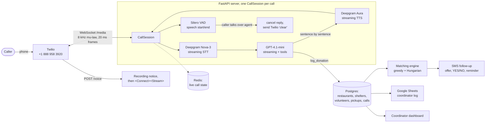

# HungerCue Voice v2

A real-time phone agent for food rescue in New York. A restaurant calls, talks
to the agent like they would to a dispatcher, and the call ends with a booked
pickup matched to a shelter and a volunteer, confirmed by text. Shelters and
volunteers call the same number to update their capacity and availability.

> **Status:** built and tested end to end in simulation (133 automated tests,
> CI green). Evaluation numbers below are filled in after the first 100-call run.
> Texting is built but **switched off until Twilio toll-free verification is
> approved**; texts are logged as "pending verification" until then.

## How a call works



1. **Twilio** answers, plays a short recording notice, and opens a two-way audio WebSocket.
2. **Voice activity detection** (Silero, run with onnxruntime) tracks when the caller starts and stops talking.
3. **Deepgram** transcribes while the caller is still speaking and detects English or Spanish.
4. **GPT-4.1-mini** streams its reply and calls tools: `set_caller_type`, `log_donation` (only after reading the details back and hearing "yes"), `update_shelter`, `update_volunteer`, `transfer_to_human`, `take_voicemail`, `end_call`.
5. Each finished sentence goes straight to **Aura text-to-speech**, so the caller hears sentence one while sentence two is still being written.
6. **Barge-in:** if the caller talks over the agent, the reply is cancelled mid-stream, Twilio is told to drop queued audio, and the model is told exactly which sentences the caller actually heard (Twilio "marks" after every sentence report what has played).
7. After a booking, the **matching engine** picks a shelter and volunteer, the volunteer gets a "Reply YES" text, a NO or 15 minutes of silence passes it to the next-best volunteer, the restaurant gets a confirmation with the volunteer's name, and the volunteer gets a reminder 30 minutes before pickup.

Returning callers are recognised by phone number ("Hi, is this another pickup from Sunrise Bagels on 112th?"). Pressing 0 at any point reaches a person.

## Latency budget

Voice-to-voice latency = time from the caller finishing speaking to the first byte of the reply. Target: **under 800 ms median, under 1.5 s at p95**.

| Stage | Budget | How it's kept small |
|---|---|---|
| Endpointing (deciding they've finished) | 200 ms | VAD silence of 224 ms or Deepgram's 200 ms endpoint, whichever comes first, and only once every word is final |
| Speech-to-text | 100 ms | streaming: the transcript is ready as they stop |
| LLM first token | 300 ms | streaming, short prompts, one tool at a time |
| TTS first byte | 150 ms | streamed per sentence, first chunk cut early at a comma; mu-law 8 kHz straight from Aura, no conversion |
| Network | 50 ms | |

Every agent reply logs each stage to the `turns` table, so the dashboard shows where the time goes.

## Matching engine

For each donation *d*, every shelter *s* and volunteer *v* pair is scored:

    score(s, v) = w1·fit(d, s) + w2·overlap(d, s) − w3·dist(d, v) − w4·dist(v, s)

- **fit:** does the shelter need this kind of food (with synonyms, so "bagels" counts as bread), and does it have room?
- **overlap:** hours shared by the pickup window and the shelter's receiving hours.
- **dist:** estimated travel minutes (straight-line distance with a city detour factor; slower and with a wait for volunteers without a car).

Before scoring, **hard rules** rule pairs out entirely: dietary conflicts (pork to a halal shelter, nuts to a nut-free one), no overlap with receiving hours, a volunteer unavailable or already booked, or a shelter without room for at least half the food.

**Live matching is greedy** (best pair, instantly, right after the call). The dashboard's **Re-optimize** button batches the day's unconfirmed pickups and solves the assignment with the **Hungarian algorithm** (`scipy.optimize.linear_sum_assignment`). A test shows the case where greedy fails: an early donation grabs the only volunteer a later one could use, while Hungarian serves both.

## Evaluation

`evals/` replays 100 fixed scenarios (50 restaurants, 25 shelters, 25 volunteers; Spanish speakers, returning callers, kitchen, street and cafe noise, mumbling, interruptions, topic changes). An LLM plays each caller from a fact sheet, Aura voices it in varied voices, and the audio goes through the **real pipeline in real time**. A simulated Twilio plays the agent's audio and echoes marks the way the real one does. No phone calls are made.

```bash
.venv/bin/python -m evals.run --suite dry     # 3 calls, one of each caller type
.venv/bin/python -m evals.run --suite smoke   # 20 calls (CI runs this on every pull request)
.venv/bin/python -m evals.run --suite full    # all 100
```

Each run writes `metrics.json`, `results.json` and `report.md` under `evals/results/`.

| Metric | Result |
|---|---|
| Caller classification accuracy | pending first run |
| Slot accuracy (items, quantity, time, address, ...) | pending first run |
| Task completion | pending first run |
| Latency p50 / p95 | pending first run |
| Barge-in success | pending first run |
| Cost per call | pending first run |

Slot accuracy uses exact, deterministic rules per field (no LLM judge), so a score can always be traced to a specific miss; see `evals/score.py`.

## Running it locally

```bash
python3.11 -m venv .venv                      # make an isolated Python environment
.venv/bin/pip install -r requirements-dev.txt # install libraries
cp .env.example .env                          # then fill in keys (see below)
.venv/bin/python -m pytest -q                 # run the test suite
.venv/bin/uvicorn hungercue.main:app --reload # start the server on http://localhost:8000
```

Without AI keys the server still starts; calls then just echo the caller's audio back (the milestone-one test).

| `.env` variable | What it is | Needed for |
|---|---|---|
| `OPENAI_API_KEY` | OpenAI API key | the agent and the eval's simulated callers |
| `DEEPGRAM_API_KEY` | Deepgram API key | speech-to-text and text-to-speech |
| `TWILIO_ACCOUNT_SID`, `TWILIO_AUTH_TOKEN` | Twilio credentials | real calls, transfers, texts, signature checks |
| `TWILIO_PHONE_NUMBER` | defaults to +18889583920 | sending texts |
| `SMS_ENABLED` | `0` until toll-free verification is approved | actually sending texts |
| `PUBLIC_BASE_URL` | the public https URL Twilio reaches (tunnel or deploy) | real calls |
| `COORDINATOR_PHONE` | where "talk to a person" forwards | transfers |
| `GOOGLE_CREDENTIALS_JSON`, `GOOGLE_SHEET_ID` | service-account file and sheet | coordinator Sheets log |
| `DASHBOARD_USER`, `DASHBOARD_PASSWORD` | dashboard login (no password = dashboard off) | `/dashboard` |
| `DATABASE_URL`, `REDIS_URL` | Postgres and Redis in production; SQLite and in-memory by default | production |

## Coordinator dashboard

`/dashboard` (HTTP Basic login): the day's pickups and match status, recent calls with transcripts and stereo recordings (caller left, agent right), the SMS log, a stacked chart of where each reply's response time went, and a button to re-optimize the day's matches.

## Privacy

- Every call starts with a recording notice.
- Transcripts and recordings are only reachable through the password-protected dashboard; audio is never served as a public file.
- Raw audio (our recordings and Twilio voicemails) is deleted after 30 days by an hourly job, unless a coordinator records that the caller agreed to keep it.

## Project layout

```
hungercue/
  main.py              FastAPI routes: /voice, /media, /sms, /voicemail, /dashboard
  services.py          builds and wires all real services at startup
  pipeline/            CallSession (the per-call orchestrator), latency, cost
  telephony/           Twilio Media Streams protocol, call control
  audio/               mu-law codec, Silero VAD, call recorder
  stt/, tts/, llm/     Deepgram streaming STT, Aura TTS, agent + tools + prompts
  matching/            scoring, greedy and Hungarian assignment, geocoding
  notify/              SMS sending and the follow-up flow (offers, replies, reminders)
  sheets/              Google Sheets coordinator log
  privacy/             30-day audio retention
  dashboard/           coordinator pages
  db/, state/          Postgres models and queries, Redis call state
evals/                 100-call evaluation suite
tests/                 pytest suite (all external services faked)
```

## Deploying (Fly.io)

`Dockerfile` and `fly.toml` are ready but **nothing has been deployed**. Deploying and pointing the phone number at it are deliberate, manual steps (see `fly.toml` comments).

## Explaining it in an interview

- **Why streaming everywhere?** A batch pipeline (record, transcribe, think, speak) adds every stage's full time together. Streaming overlaps them: transcription finishes as the caller stops, and TTS starts on the first sentence while the model is still writing. That's how the reply can start in well under a second.
- **How does barge-in work?** Three concurrent asyncio tasks per call (listening, transcribing, speaking). When VAD hears the caller during the agent's turn, the speaking task is cancelled. Python's task cancellation stops the LLM stream and TTS requests in flight, and a Twilio `clear` drops audio already queued. Because the LLM usually finishes writing long before the audio finishes playing, per-sentence Twilio marks tell us what was really heard, and the model is told what was cut off.
- **How do you know it works?** Unit tests for every module with every external service faked, an offline end-to-end call test, and an eval that pushes 100 realistic simulated calls through the real pipeline in real time and scores each captured field against ground truth. CI runs a 20-call version on every pull request and fails on regressions.
- **Hardest bug?** An intermittent test hang. Shutdown cancelled a background task mid-database-query without waiting for it, so SQLAlchemy's connection cleanup was left waiting on a driver thread that had already exited. It was found by instrumenting the event loop to print the stuck task, reproduced, then fixed by awaiting cancelled tasks before closing the database, with a regression test that fails without the fix.
- **Why greedy and Hungarian?** Greedy is instant and right for a single new donation; Hungarian is optimal for a batch. There's a test showing a case where greedy strands a donation and Hungarian doesn't.
